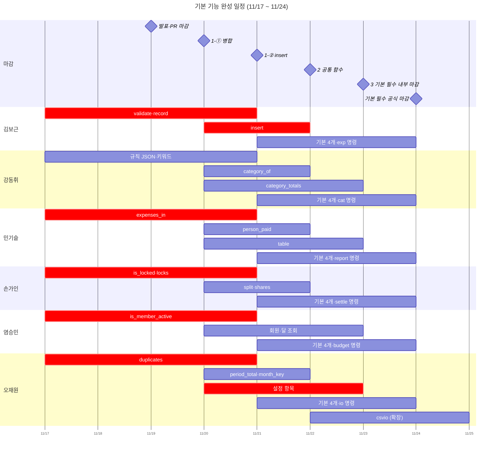

# 역할 분담과 작업 순서

함께 보는 문서: [작업방식_협업규칙.md](작업방식_협업규칙.md) · [공통모듈_함수규격.md](공통모듈_함수규격.md) · [규약.md](규약.md) · [은행거래내역형식.md](은행거래내역형식.md)

- 제안발표: **11/19(목)**. 공식 마감: 기본 필수 **11/24(화) 23:59**, 최종 **12/1(화) 23:59**.
- 마감은 **병합된 시각**으로 판정하므로 팀 내부 마감은 하루 전 23:59(**11/23**, **11/30**)다. 확장 필수는 그보다 앞선 **11/28** 까지 병합한다. 이 문서의 날짜는 모두 병합 완료 기준이다.
- 담당이나 날짜가 바뀌면 이 문서를 먼저 고친다. 공통모듈_함수규격.md 의 담당표는 이 문서에 맞춘다.
- 근거: 「스켈레톤 코드 구조와 구현 순서」 2~3장, 구조 그림의 채움/씀 꼬리표

**이 문서 읽는 법**: 1장에서 내 담당을 찾고 → 2장에서 날짜를 보고 → 4장의 **내 이름 절**만 읽으면 된다.

---

## 1. 한눈에 보기

| 담당자 | 기능 | 기능 파일 · 명령 | 채울 공통 함수 | 팀 공동 작업 |
|---|---|---|---|---|
| 김보근 | 1. 지출 입력·관리 | `features/expenses.py` · `exp`, `member`(add·leave·list) | `ledger.validate`, `ledger.insert` | 로그 |
| 강동휘 | 2. 분류 규칙 | `features/categorize.py` · `cat` | `queries.category_of`, `queries.category_totals` | 통합 시나리오 테스트 |
| 민기슬 | 3. 보고서 | `features/report.py` · `report` | `queries.expenses_in`, `queries.person_paid`, `textfmt.table`, `textfmt.bar_chart` | 자료 파일 손상 대응 |
| 손가인 | 4. 정산 | `features/settle.py` · `settle` | `money.split`(비율), `queries.expense_shares`, `queries.member_shares`, `queries.is_locked` | 통합 실행 |
| 염승민 | 5. 예산·회비 | `features/budget.py` · `budget` | `queries.is_member_active`, `queries.active_members`, `dates.months_between` | 사용 설명서 |
| 오재원 | 6. 가져오기·내보내기 | `features/transfer_io.py` · `io` | `ledger.duplicates`, `dates.month_key`, `queries.period_total`, `csvio.detect_encoding`, `csvio.read_csv_rows` | 설정 파일, `member load` |

### 배정 근거

- 공통 함수를 많이 채우거나 다른 사람이 기다리는 함수를 맡은 사람(김보근 `insert`, 민기슬 `expenses_in`)에게 고칠 파일이 겹치지 않는 공동 작업을 붙였다.
- 기능과 관련 있는 공동 작업을 맡겼다: 정산(손가인) ↔ 명령을 모두 묶는 통합 실행, 보고서 합계(민기슬) ↔ 자료 저장, 가져오기·내보내기(오재원) ↔ 설정 파일·명부 읽기, 분류(강동휘) ↔ 기능을 이어서 검사하는 시나리오 테스트, 예산(염승민) ↔ 설정·명령 사용법을 쓰는 설명서.

### 모든 사람에게 공통인 일

- 기능 파일의 함수 이름과 인자는 바꾸지 않는다. 함수는 추가만 한다(규약 8).
- 다른 기능 파일을 import 하지 않는다. 같이 써야 하는 계산은 `moim/common` 으로 옮긴다(`tools/check_imports.py` 가 검사).
- 자기 기능의 테스트를 `tests/test_<기능>.py` 에 쓴다. 경계값(0원, 1원 나머지, 말일, 윤년, 탈퇴일 당일, 확정 기간 끝일)을 포함한다.
- 공통모듈_함수규격.md 에서 자기 절을 읽고 `제안` → `**확정** — 이름 (날짜)` 로 바꾼다.
- 명령이 정해지면 사용 예와 출력 예를 염승민(사용 설명서)에게 알린다.
- 남이 채울 공통 함수를 기다릴 때는 내 테스트에서 `store.data["expenses"]` 에 dict 를 직접 넣어 먼저 진행한다.

---

## 2. 일정

### 2-1. 단계

| 단계 | 내용 | 병합 목표 |
|---|---|---|
| 준비 | 각자 첫 공통 함수 작성 | 11/17(화) ~ 11/18(수) |
| PR 마감 | 1-① 병합 요청 올리기 · **제안발표** | 11/19(목) |
| 1-① | 바닥 공통 함수: `validate`·`record`·`history`·`deleted`(김보근), `is_locked`·`locks`(손가인), `is_member_active`(염승민), `duplicates`(오재원), `expenses_in`(민기슬) | 11/20(금) |
| 1-② | `ledger.insert`(김보근). 1-①이 병합된 뒤 올린다 → 이때부터 기본 테스트가 실제로 돈다 | 11/21(토) |
| 2 | 각자의 나머지 공통 함수와 자료 항목, 설정 파일 항목(오재원). 일부(`split` 비율·`expense_shares`·`member_shares`·`person_paid`·`category_of`·`month_key`·`period_total`)는 11/21로 앞당김(Notion 결정 기록) | 11/22(일) |
| 3 | 기본 필수 4개 + 명령 + 테스트, 확장 필수용 공통 함수의 **이름·인자만** | **11/23(월) 내부 마감** |
| 예비 | 검토 지연·충돌 해결만 | 11/24(화) 23:59 공식 마감 |
| 4 | 확장 필수 4개 | 11/28(토) |
| 4 | 선택 2개 이상(2-5), 팀 공동 작업 완성 | 11/30(월) 내부 마감 |
| — | 인수 테스트 공개(실패하면 고치기 전에 원인 커밋 기록) | 11/25(수) |

### 2-2. 날짜별 · 사람별

**굵은 글씨**는 다른 사람이 기다리는 작업이다. 늦어질 것 같으면 바로 팀에 알린다.

| 날짜 | 김보근 (1) | 강동휘 (2) | 민기슬 (3) | 손가인 (4) | 염승민 (5) | 오재원 (6) |
|---|---|---|---|---|---|---|
| 11/17~18 준비 | `validate`·`record` 작성 | 규칙 JSON·키워드 분류 작성 | `expenses_in` 작성 | `is_locked` 작성 | `is_member_active` 작성 | `duplicates` 작성, 설정 항목 초안 |
| 11/19 발표·PR | 1-① 검토 | 1-① 우선 검토 | `expenses_in` PR | `is_locked` PR | `is_member_active` PR | `duplicates` PR |
| 11/20 병합 | `history`·`deleted`, `record`, `validate` | (기능 작업) | **`expenses_in`** | `locks`, **`is_locked`** | **`is_member_active`** | **`duplicates`** |
| 11/21 병합 | **`insert`** | 지출의 `category_fixed`, `category_of` | **`person_paid`** | `weights` 형식, `split` 비율, `expense_shares`, `member_shares` | | `month_key`, **`period_total`** |
| 11/22 병합 | | `category_totals` | **`table`** | | `payments`, `active_members`, **`months_between`** | **설정 항목** |
| 11/23 내부 마감 | 기본 4개 + `exp`·`member` | 기본 4개 + `cat` | 기본 4개 + `report`, `bar_chart` | 기본 4개 + `settle`, `transfers`·`recurring`·지출의 `recurring_id` 이름 | 기본 4개 + `budget` | 기본 4개 + `io` |
| 11/24 예비 | | 시나리오 테스트 틀 | | | | **`csvio`** (확장, 염승민이 씀) |
| 11/26 병합 | **로그 `get_logger`** | | **`Store.save` 안전 저장·백업, `backups`·`recover`·복구 안내** | | 사용 설명서: 설치·실행·설정 | **`member load`** |
| 11/27 병합 | 로그 `cli.py` 연결 확인 | | | `init`, 로그·복구 연결 | | |
| 11/28 병합 | 확장 필수 | 확장 필수 | 확장 필수 | 확장 필수 | 확장 필수 | 확장 필수 |
| 11/30 내부 마감 | 선택 | 선택, 시나리오 전체 통과 | 선택 | 선택 | 선택, 사용 설명서: 명령마다 사용 예·출력 예 | 선택 |

### 2-3. 팀 공동 작업 일정

| 작업 | 담당 | 먼저 할 것 (기다리는 사람) | 병합 목표 | 나머지 | 병합 목표 |
|---|---|---|---|---|---|
| 설정 파일 | 오재원 | `DEFAULT`·`PATH_KEYS` 항목 (염승민 예산, 김보근 로그, 민기슬 백업, 손가인 `init`) | **11/22** | `member load` 명령 (김보근 승인) | 11/26 |
| 통합 실행 | 손가인 | 오류 안내("오류: 이유", 종료 코드 1) | 11/23 | `init`, 로그·복구 연결 | 11/27 |
| 통합 시나리오 테스트 | 강동휘 | `tests/test_scenario.py` 틀 (안 된 기능은 건너뜀) | 11/24 | 6장 시나리오 전체 통과 | 11/30 |
| 로그 | 김보근 | `get_logger` 파일 기록·핸들러 중복 방지 | 11/26 | `cli.py` 연결 확인 | 11/27 |
| 자료 파일 손상 대응 | 민기슬 | `Store.save` 안전 저장·백업 | 11/26 | `backups`, `recover`, 복구 안내 | 11/26 |
| 사용 설명서 | 염승민 | 설치·실행·설정 설명 | 11/26 | 명령마다 사용 예·출력 예 | 11/30 |

### 2-4. 간트 차트

막대 끝이 병합 목표일이다. 빨간 막대는 다른 사람이 기다리는 작업, ◆는 마감이다. GitHub 에서 열면 그림으로 보인다. 하루짜리 작은 작업은 뺐으니 정확한 날짜는 2-2 표를 본다.



### 2-5. 선택 요구사항 (각자 고른 것)

공고문의 선택 요구사항 가운데 각자 구현할 것이다. 2개 이상이면 되고, 병합 목표는 **11/30(월) 내부 마감**이다.

| 담당 | 기능 | 고른 선택 |
|---|---|---|
| 김보근 | 1 지출 입력·관리 | 삭제한 지출 되살리기, 직전 수정 되돌리기, 삭제된 지출까지 보이는 목록 |
| 강동휘 | 2 분류 규칙 | 낸 사람·금액 범위로도 분류하는 규칙, 규칙 겹침 검사, 분류 결과 미리 보기 |
| 민기슬 | 3 보고서 | 요일별·주별 지출, 여러 달 추이 표 |
| 손가인 | 4 정산 | 이미 보낸 송금 반영(부분 정산), 정산 내역서, 이전 정산과 비교, 특정 지출에서 특정 사람 빼기 |
| 염승민 | 5 예산·회비 | 월말 지출 예측, 예산 대비 실제 지출 표 |
| 오재원 | 6 가져오기·내보내기 | 가져오기 미리 보기, 내보낸 파일을 다시 읽어 원래 기록과 대조(왕복 검증) |

---

## 3. 의존 관계

```
[1-①] is_locked(손가인) ────────┐
      is_member_active(염승민) ──┼─▶ [1-②] insert(김보근) ─▶ 지출 추가가 돈다 ─▶ 기능 2~6 기본 테스트가 돈다
      duplicates(오재원) ────────┤
      validate·record(김보근) ───┘

      expenses_in(민기슬) ─▶ period_total(오재원) · category_totals(강동휘) · person_paid(민기슬)
                             · member_shares(손가인) ─▶ 보고서·정산·예산·내보내기 합계
```

`store.py` 의 `EMPTY` 에는 한 병합 요청에 자료 항목 하나씩 추가한다. 따로 정한 순서는 없고 2-2 의 날짜를 따르며, 올리기 전에 main 을 받아 합친다.

---

## 4. 사람별 할 일

각 절은 같은 순서다: **내가 내놓을 것**(남이 기다림) → **내가 기다리는 것** → **할 일 목록** → **기다리는 동안**.

### 김보근 — 기능 1 지출 입력·관리 + 로그

> 다른 사람이 기다리는 가장 큰 일: **`insert`(11/21)**. 기본 테스트 대부분이 지출 추가로 자료를 만든다.

| 내가 내놓을 것 | 기다리는 사람 | 병합 목표 |
|---|---|---|
| `history`·`deleted` 자료 항목, `Store.record` | 전원 (수정 이력), 손가인 | 11/20 |
| `ledger.validate` | 오재원 (가져오기 미리 보기) | 11/20 |
| **`ledger.insert`** | 손가인·염승민·오재원 | **11/21** |
| 로그 `get_logger` | 손가인 (`cli.py` 연결) | 11/26 |

| 내가 기다리는 것 | 담당 | 예정 | 어디에 씀 |
|---|---|---|---|
| `queries.is_locked` | 손가인 | 11/20 | `insert`, 수정·삭제 거부 |
| `queries.is_member_active` | 염승민 | 11/20 | `insert` 의 참여자 검사 |
| `ledger.duplicates` | 오재원 | 11/20 | 지출 추가 시 중복 의심 경고 |
| `weights` 형식 | 손가인 | 11/21 | 지출 추가·수정의 사람별 비율 |
| `textfmt.table` | 민기슬 | 11/22 | 지출 목록 출력 |
| 설정의 `log_dir` | 오재원 | 11/22 | 로그 폴더 위치 |

**할 일 목록**
- 공통 함수: [ ] `ledger.validate` → `("YYYY-MM-DD", 원)` 또는 `ValueError` · [ ] `ledger.insert` → 검사, 확정 기간 거부, `store.data` 에 추가, 이력 기록 (파일 저장은 `cli.py` 가 함)
- 자료 항목: [ ] 지출의 `deleted` · [ ] `history` 와 `Store.record`
- 기능 함수 (`features/expenses.py`)
  - [ ] 명부: `add_member`, `leave_member`, `load_members_file`(오재원이 승인 받아 채움), `list_members`
  - [ ] 지출: `add_expense`(→ `(지출, 경고 목록)`), `list_expenses`, `edit_expense`, `delete_expense`, `restore_expense`
  - [ ] 이력: `undo_last_edit`, `history`
  - [ ] 여러 줄 입력: `add_from_file` (`tools/gen_data.py` 의 `expenses.csv` 형식)
- 명령: [ ] `commands/expenses.py`(`exp`) · [ ] `commands/members.py` 의 add·leave·list
- 공동 작업 로그 (`common/log.py`): [ ] `log_dir/YYYY-MM-DD.log` 에 UTF-8 로 덧붙임, 형식 `2026-11-16 17:32:15 INFO 지출 추가 1번 36,000원` · [ ] 여러 번 불러도 핸들러 중복 없음

**기다리는 동안**: `validate` 와 `record` 를 먼저 끝낸다. `insert` 는 세 함수를 부르는 코드를 미리 써 둔다.

### 강동휘 — 기능 2 분류 규칙 + 통합 시나리오 테스트

> 1단계 공통 함수가 없으므로 초반에는 **다른 사람의 1-① 병합 요청을 우선 검토**한다(발표 전 검토 기록).

| 내가 내놓을 것 | 기다리는 사람 | 병합 목표 |
|---|---|---|
| `queries.category_of` ("미분류") | 오재원 (분류로 골라 내보내기) | 11/21 |
| `queries.category_totals` | 민기슬 (분류별 합계), 염승민 (분류별 예산) | 11/22 |
| 지출의 `category_fixed` 자료 항목 | (본인) | 11/21 |
| 시나리오 테스트 틀 | 전원 (통합 확인) | 11/24 |

| 내가 기다리는 것 | 담당 | 예정 | 어디에 씀 |
|---|---|---|---|
| `queries.expenses_in` | 민기슬 | 11/20 | 분류별 집계, 미분류 목록 |
| `ledger.insert` | 김보근 | 11/21 | 실제 지출로 확인 |
| 모든 기능과 `cli.main([...])` | 전원, 손가인 | 11/28 | 시나리오 테스트 |

**할 일 목록**
- 공통 함수: [ ] `queries.category_of` (`UNCATEGORIZED` 사용) · [ ] `queries.category_totals` → `{분류: {"count", "amount"}}`
- 자료 항목: [ ] 지출의 `category_fixed` (11/21)
- 기능 함수 (`features/categorize.py`)
  - [ ] 규칙 파일: `load_rules`, `save_rules` (JSON)
  - [ ] 규칙: `add_rule`, `remove_rule`, `matches`, `classify`(우선순위 → 등록 순서), `overlaps`
  - [ ] 적용: `apply_rules`(고정 건너뜀, `preview`), `set_category`, `unfix_category`, `uncategorized`, `summary`
- 명령: [ ] `commands/categorize.py`(`cat`)
- 공동 작업 통합 시나리오 테스트 (`tests/test_scenario.py`)
  - [ ] `tools/gen_data.py` 자료로 처음부터 끝까지 (6장 시나리오), 명령행은 `cli.main([...])`
  - [ ] 규약 값이 기능끼리 같은지: 사사오입, 나머지 1원, 기간 포함, 탈퇴일, 미분류, 확정 기간 (검사값은 공통모듈_함수규격.md 의 예)
  - [ ] 아직 안 된 기능은 건너뜀(skipped)으로 표시해 `check` 가 깨지지 않게

**기다리는 동안**: 11/17~20에 규칙 JSON 저장·읽기와 키워드 분류를 만든다. 시나리오 테스트 틀은 일찍 만들고 기능이 들어오는 대로 채운다.

### 민기슬 — 기능 3 보고서 + 자료 파일 손상 대응

> 다른 사람이 기다리는 가장 큰 일: **`expenses_in`(11/20)** — 전원이 쓴다.

| 내가 내놓을 것 | 기다리는 사람 | 병합 목표 |
|---|---|---|
| **`queries.expenses_in`** | **전원** | **11/20** |
| `queries.person_paid` | 손가인 | 11/21 |
| `textfmt.table` | 김보근·손가인·염승민 | 11/22 |
| `textfmt.bar_chart` | 김보근·손가인·염승민 (명령에서 쓸 수 있음) | 11/23 |
| `Store.save` 안전 저장·백업 | 손가인 (복구 안내) | 11/26 |

| 내가 기다리는 것 | 담당 | 예정 | 어디에 씀 |
|---|---|---|---|
| `queries.period_total`, `dates.month_key` | 오재원 | 11/21 | 월별·기간 합계 |
| `queries.category_totals` | 강동휘 | 11/22 | 분류별 합계 |
| `dates.months_between` | 염승민 | 11/22 | 전월 대비, 여러 달 추이 |
| 설정의 `backup_dir` | 오재원 | 11/22 | 백업 폴더 위치 |

**할 일 목록**
- 공통 함수: [ ] `queries.expenses_in` (날짜순, 삭제 제외) · [ ] `queries.person_paid` · [ ] `textfmt.table`, `textfmt.bar_chart` (한글 폭 `width`)
- 기능 함수 (`features/report.py`)
  - [ ] 합계: `monthly_totals`, `period_summary`(`total`, `by_category`, `by_person`), `month_over_month`
  - [ ] 나눠 보기: `weekday_totals`, `week_totals`(월요일 시작), `top_expenses`, `biggest_day`
  - [ ] 보고서: `month_report`, `save_report`(.txt)
  - [ ] 검색: `search` (기간·사람·금액 범위·낱말, 삭제 제외)
- 명령: [ ] `commands/report.py`(`report`)
- 공동 작업 자료 파일 손상 대응 (`common/store.py`)
  - [ ] `Store.save` — 직전 자료를 `backup/` 에 복사, 임시 파일에 쓴 뒤 `os.replace`, 최근 10개만
  - [ ] `Store.backups` (오래된 것부터) · [ ] `Store.recover` (깨진 파일을 옆에 남기고 최근 정상 백업, `recovered_from`)

**기다리는 동안**: `expenses_in` 을 가장 먼저 올린다. 합계는 직접 더하지 말고 공통 함수만 쓴다(그래야 정산·내보내기와 합계가 같다).

### 손가인 — 기능 4 정산 + 통합 실행

> 다른 사람이 기다리는 가장 큰 일: **`is_locked`(11/20)** — `insert` 가 쓴다.

| 내가 내놓을 것 | 기다리는 사람 | 병합 목표 |
|---|---|---|
| `locks` 자료 항목, **`queries.is_locked`** | 김보근, 오재원 | **11/20** |
| `weights` 형식 | 김보근 | 11/21 |
| `money.split` 비율 부분 | 염승민 (회비 차감) | 11/21 |
| `queries.expense_shares`, `queries.member_shares` | (본인), 염승민 | 11/21 |
| `transfers`, `recurring`, 지출의 `recurring_id` 자료 항목 (이름만) | (본인) | 11/23 |
| 오류 안내 (`cli.py`) | 전원의 명령 | 11/23 |
| `init`, 로그·복구 연결 | 강동휘 (시나리오의 명령행 실행) | 11/27 |

| 내가 기다리는 것 | 담당 | 예정 | 어디에 씀 |
|---|---|---|---|
| `queries.expenses_in` | 민기슬 | 11/20 | 기간 안의 지출 |
| `ledger.insert` | 김보근 | 11/21 | 반복 지출 생성 |
| `queries.person_paid` | 민기슬 | 11/21 | 낸 돈 |
| `textfmt.table` | 민기슬 | 11/22 | 정산 표 |
| `dates.months_between` | 염승민 | 11/22 | 반복 지출 |
| 설정 항목 · 로그 · 복구 | 오재원 · 김보근 · 민기슬 | 11/22 · 11/26 · 11/26 | `init`, `cli.py` 연결 |

**할 일 목록**
- 공통 함수: [ ] `money.split` 비율 분배 (합계는 항상 원래 금액) · [ ] `expense_shares`, `member_shares` · [ ] `is_locked`
- 자료 항목: [ ] `locks` · [ ] `weights` · [ ] `transfers` · [ ] `recurring` · [ ] 지출의 `recurring_id`
- 기능 함수 (`features/settle.py`)
  - [ ] 정산: `balances`(잔액 = 낸 돈 − 부담 + 보낸 송금 − 받은 송금), `balance_sum`, `minimal_transfers`
  - [ ] 송금·확정: `record_transfer`, `lock_period`(잔액 합 0 아니면 거부)
  - [ ] 내역: `statement`, `exclude_member`, `compare`
  - [ ] 반복 지출: `add_recurring`, `run_recurring`(없는 날은 말일)
- 명령: [ ] `commands/settle.py`(`settle`)
- 공동 작업 통합 실행 (`moim/cli.py`): [ ] 오류를 "오류: 이유" 한 줄로, 종료 코드 1 · [ ] `init`(`config.save_default`) · [ ] 로그 연결 · [ ] 깨진 자료 파일 복구 안내 · [ ] 각 명령 묶음이 잘 붙는지 확인

**기다리는 동안**: `is_locked` 를 발표 전에 올린다. 부담액은 `expense_shares` → `member_shares` 순서로 만든다.

### 염승민 — 기능 5 예산·회비 + 사용 설명서

> 다른 사람이 기다리는 가장 큰 일: **`is_member_active`(11/20)** — `insert` 가 쓴다.

| 내가 내놓을 것 | 기다리는 사람 | 병합 목표 |
|---|---|---|
| **`queries.is_member_active`** | 김보근 | **11/20** |
| `payments` 자료 항목, `queries.active_members` | (본인: 회비 입금, 은행 출금의 참여자) | 11/22 |
| `dates.months_between` | 민기슬, 손가인 | 11/22 |
| 사용 설명서 | 전원 (제출물) | 11/30 |

| 내가 기다리는 것 | 담당 | 예정 | 어디에 씀 |
|---|---|---|---|
| 설정 항목 (월 예산, 분류별 예산, 회비, 경보 비율, 총무) | 오재원 | 11/22 (이름은 11/20 합의) | 월 예산 설정 (기본 필수) |
| `ledger.insert` | 김보근 | 11/21 | 은행 출금을 지출로 |
| `queries.period_total` | 오재원 | 11/21 | 이번 달 지출, 통장 잔고 |
| `queries.category_totals` | 강동휘 | 11/22 | 분류별 예산 (확장) |
| `money.split` 비율, `member_shares` | 손가인 | 11/21 | 회비 차감 (선택, 2-5 에서는 고르지 않음) |
| `textfmt.table` | 민기슬 | 11/22 | 예산 대비 실제 표 |
| `csvio.detect_encoding`, `read_csv_rows` | 오재원 | 11/24 | 은행 거래내역 가져오기 (확장) |
| 각자의 명령 사용 예 | 전원 | 수시 | 사용 설명서 |

**할 일 목록**
- 공통 함수: [ ] `queries.is_member_active`, `queries.active_members` · [ ] `dates.months_between`
- 자료 항목: [ ] `payments`
- 기능 함수 (`features/budget.py`)
  - [ ] 예산: `month_status`, `category_status`(80% 초과 경보), `forecast`, `budget_table`, `suggest_budget`
  - [ ] 회비: `record_payment`, `treasury_balance`, `unpaid`, `dues_deduction`
  - [ ] 은행: `import_bank` (은행거래내역형식.md, 같은 파일 두 번 가져와도 한 번만)
- 명령: [ ] `commands/budget.py`(`budget`)
- 공동 작업 사용 설명서 (`README.md`): [ ] 설치·실행(`python -m moim`, `init`) · [ ] 설정 파일 항목 설명 · [ ] 명령 묶음마다 사용 예·출력 예 · [ ] 연습 자료 만들기와 테스트 실행 방법

**기다리는 동안**: `is_member_active` 를 가장 먼저 올린다. 오재원과 설정 항목 이름을 11/20까지 정한다.

### 오재원 — 기능 6 가져오기·내보내기 + 설정 파일

> 다른 사람이 기다리는 가장 큰 일: **`duplicates`(11/20)**, **설정 항목(11/22)**, `period_total`(11/21).

| 내가 내놓을 것 | 기다리는 사람 | 병합 목표 |
|---|---|---|
| **`ledger.duplicates`** | 김보근 | **11/20** |
| 설정 항목 이름 합의 | 염승민 | 11/20 |
| `queries.period_total`, `dates.month_key` | 민기슬, 염승민 | 11/21 |
| **설정 `DEFAULT`·`PATH_KEYS`** | 염승민·김보근·민기슬·손가인 | **11/22** |
| `csvio.detect_encoding`, `csvio.read_csv_rows` | 염승민 | 11/24 |
| `member load` (김보근 승인) | 전원 (명부 반영) | 11/26 |

| 내가 기다리는 것 | 담당 | 예정 | 어디에 씀 |
|---|---|---|---|
| `queries.expenses_in` | 민기슬 | 11/20 | 기간 골라 내보내기, 합계 검사 |
| `ledger.validate`, `ledger.insert` | 김보근 | 11/20, 11/21 | CSV 가져오기와 미리 보기 |
| `queries.category_of` | 강동휘 | 11/21 | 분류 골라 내보내기 |
| `load_members_file` 승인 | 김보근 | 11/26 | `member load` |

**할 일 목록**
- 공통 함수: [ ] `ledger.duplicates` · [ ] `dates.month_key` · [ ] `queries.period_total` · [ ] `csvio.detect_encoding`, `csvio.read_csv_rows`
- 기능 함수 (`features/transfer_io.py`)
  - [ ] 내보내기: `export_csv`(UTF-8 BOM), `export_json` → `(건수, 합계)`
  - [ ] 검증: `file_total`, `verify_export`, `roundtrip_check`
  - [ ] 가져오기: `import_csv` (인코딩 판별, 열 이름 연결, 미리 보기, 중복·오류 줄 번호)
  - [ ] 백업: `backup_all`, `restore_all`, `merge`(지출 번호 새로 매김)
- 명령: [ ] `commands/transfer_io.py`(`io`)
- 공동 작업 설정 파일 (`common/config.py`, `commands/members.py`)
  - [ ] `DEFAULT` 에 `members_file`, `rules`, `backup_dir`, `log_dir`, `treasurer`, `budget`, `dues`, `warn_ratio`
  - [ ] `PATH_KEYS` 에 `members_file`, `rules`, `backup_dir`, `log_dir`
  - [ ] JSON 이 아닌 설정 파일은 `ValueError`
  - [ ] `member load` — 설정의 `members_file` 을 `load_members_file` 로 읽기

**기다리는 동안**: `duplicates` 를 먼저 올린다. 내보내기는 `store.data["expenses"]` 에 dict 를 직접 넣고 테스트한다.

---

## 5. 위험과 대응

### 5-1. 팀원이 빠질 때 대신 맡는 사람

작업이 **이틀 넘게** 진행되지 않거나, 불참을 미리 알렸는데 기다리는 사람이 있는 작업이면 아래 사람이 이어받는다. 이어받는 사람은 그 함수를 실제로 쓰는 **주 검토자**이고, 주 검토자도 어려우면 **보조 검토자**가 맡는다(작업방식_협업규칙.md 6절). 이어받은 작업은 원래 담당자 이름을 병합 요청 설명에 적고, 돌아오면 다시 넘긴다.

| 빠진 사람 | 대신 맡는 사람 (주 검토자) | 우선 이어받을 작업 | 그다음 (보조 검토자) |
|---|---|---|---|
| 김보근 | 손가인 | `ledger.validate`, `ledger.insert` | 염승민 |
| 강동휘 | 민기슬 | `category_of`, `category_totals` | 손가인 |
| 민기슬 | 강동휘 | `expenses_in`, `person_paid`, `textfmt.table` | 오재원 |
| 손가인 | 김보근 | `is_locked`, `split` 비율, `expense_shares`·`member_shares` | 강동휘 |
| 염승민 | 오재원 | `is_member_active`, `active_members`, `months_between` | 김보근 |
| 오재원 | 염승민 | `duplicates`, `period_total`, `csvio`, 설정 항목 | 민기슬 |

- 이어받는 범위는 **다른 사람이 기다리는 공통 함수**까지다. 그 사람의 기능 파일(기본·확장 필수)은 개인 점수라 본인이 하되, 늦어지면 팀장이 일정을 다시 잡는다.
- 팀장(손가인)이 빠지면 관리자 김보근(dajugeum07)이 저장소 관리와 검토 건수 집계를 맡는다.

### 5-2. 일정 위험

| 위험 | 막히는 것 | 미리 막는 법 | 생기면 대응 |
|---|---|---|---|
| `expenses_in`(민기슬) 지연 | 전원의 기간 계산 | 11/19까지 PR, 검토 최우선 | 11/21까지 병합이 안 되면 5-1 대신 맡는 사람이 이어받음 |
| `is_locked`·`is_member_active`·`duplicates` 지연 | `insert` → 기능 2~6 테스트 | 셋 다 11/19까지 PR | 기다리는 쪽은 dict 직접 입력으로 테스트를 먼저 쓴다 |
| `insert`(김보근) 지연 | 실제 지출이 들어가는 모든 테스트 | 1-① 병합 즉시 PR | 11/21을 넘기면 팀장·관리자가 함께 검토, 11/22를 넘기면 손가인이 이어받음 |
| 설정 항목(오재원) 지연 | 예산·로그·백업·`init` | 11/20에 항목 이름만 먼저 합의해 공통모듈_함수규격.md 8-2 에 적음 | 이름만 정해지면 각자 `cfg.get("이름", 기본값)` 으로 먼저 쓴다 |
| 팀원의 작업 지연·불참 | 그 사람의 기능과 그것을 기다리는 사람 | 하루 전에 팀 대화방에 알림, 월·목 중간 점검 | 5-1 표대로 이어받음. 기다리는 쪽은 부르는 코드와 dict 테스트를 먼저 쓴다 |
| 마감 직전 승인 대기 | 마감 미반영 | 내부 마감 11/23·11/30 | 주 검토자가 답이 없으면 보조 검토자 → 팀장 순으로 넘김 |
| 11/25 인수 테스트에서 실패가 많이 나옴 | 확장 필수 일정(11/28) | 기본 필수 단계에서 공통모듈_함수규격.md 예시를 테스트로 만들어 둠 | 고치기 전에 원인 커밋을 `git bisect` 로 찾아 감사 기록에 남기고 `git revert` 또는 새 커밋으로 고침 |

### 5-3. 코드·규약 위험

| 위험 | 막히는 것 | 미리 막는 법 | 생기면 대응 |
|---|---|---|---|
| 같은 공통 모듈 파일(`store.py` 의 `EMPTY`, `queries.py`) 동시 수정 | 충돌, 남의 변경 삭제 | `EMPTY` 는 한 병합 요청에 한 항목, 자기 함수 본문만 수정, 올리기 전에 main 받아 합치기 | 두 변경 모두 살리고 쓴 사람에게 확인 후 테스트(작업방식_협업규칙.md 8절) |
| 규약과 다른 값 구현 (`round()` 사용, 끝일 제외, 탈퇴일 당일 제외 등) | 다른 기능 전체의 결과, 인수 테스트 | 검토 확인 항목 7-1 의 규약 대조, 공통모듈_함수규격.md 의 경계값 예시를 테스트로 작성 | 감사 보고서용으로 원인 커밋·바뀐 줄·깨진 테스트를 먼저 기록한 뒤 고침 |
| 확정된 함수 규격을 나중에 바꿔야 함 | 그 함수를 쓰는 기능 | 이름·인자는 스켈레톤 그대로, 새 기능은 함수를 **추가**해서 해결 | 담당자와 쓰는 사람이 함께 정하고, 무엇을 왜 바꿨는지 공통모듈_함수규격.md 병합 요청 설명에 남김 |
| 보고서·정산·내보내기 합계 불일치 | 통합 시나리오 테스트 (팀 점수) | 합계는 `period_total`, `member_shares` 같은 공통 함수로만 계산, 기능 안에서 따로 더하지 않음 | 시나리오 테스트에서 어긋난 기능을 찾아 공통 함수로 바꿈 |
| 기능 파일끼리 import | `check` 실패로 병합 불가 | 함께 쓰는 계산은 처음부터 `moim/common` 에 둠 | 그 계산을 공통 모듈로 옮기는 병합 요청을 따로 올림 |
| Windows·Mac 환경 차이 (한글 인코딩, 경로) | 한 사람 컴퓨터에서만 통과하는 테스트 | 파일을 열 때 `encoding="utf-8"` 명시, 경로는 `os.path.join`, CSV 는 `csvio` 함수만 사용 | 검토자가 다른 운영체제에서 한 번 실행해 보고 결과를 검토 의견에 적음 |

### 5-4. 협업·Git 위험

| 위험 | 막히는 것 | 미리 막는 법 | 생기면 대응 |
|---|---|---|---|
| `git config user.email` 이 계정과 달라 기여가 안 잡힘 | 개인 점수(협업 기여) | 첫 커밋 뒤 GitHub 커밋 목록에서 프로필 사진이 뜨는지 확인. 팀장이 11/19 전에 6명 확인 | 이메일을 고치고 이후 커밋부터 바르게 남김(이미 올라간 커밋은 덮어쓰지 않음) |
| 형식적인 검토("확인했습니다")나 검토 몰림 | 검토 건수 미인정, 분담 균등성 | 7-2 형식으로 실행한 명령과 대조한 줄을 적음 | 팀장이 월·목에 사람별 검토 건수를 세어 모자란 사람에게 배정 |
| 한 병합 요청에 여러 변경·300줄 초과 | 협업 기여 점수 | 공통 함수 → 기능 함수 → 명령 순서로 나눠 올림 | 올리기 전에 `git diff --stat main` 으로 줄 수 확인, 넘으면 브랜치를 나눔 |
| main 에 실수로 커밋 | push 거부, 섞인 기록 | 작업 시작은 항상 `git checkout main` → `git pull` → `git checkout -b 새브랜치` | push 전이면 `git reset --soft HEAD~1` 후 브랜치로 옮김, 병합된 뒤면 `git revert` |
| 줄 끝(CRLF/LF) 차이로 파일 전체가 바뀐 것으로 보임 | 검토하기 어려운 diff, 충돌 | Mac 은 `core.autocrlf input`, Windows 는 `true`, VS Code 는 LF | 내용 변경 없이 줄 끝만 바뀐 파일은 커밋하지 않음(`git restore 파일`) |

## 6. 마무리 확인 (12/1 전)

- [ ] 통합 시나리오(강동휘 주관, 전원 확인): `python tools/gen_data.py sample --month 2026-11` 로 연습 자료를 만들어 처음부터 끝까지 실행
  `init` → `member load` → `exp import-lines` → `cat` 적용 → `report` → `settle` → `budget import-bank` → `io` 내보내기·검증
- [ ] 보고서·정산·내보내기의 합계가 서로 같은지
- [ ] 자료 파일을 일부러 깨뜨려 복구가 되는지, 로그가 남는지
- [ ] 규약 값(사사오입, 나머지 1원, 기간 포함, 탈퇴일, 미분류, 확정)이 모든 기능에서 같게 나오는지
- [ ] GitHub Actions(`check`)가 모두 통과
- [ ] README 의 사용 예를 그대로 실행해 출력이 맞는지
- [ ] `config.json`, `data.json`, `backup/`, `logs/` 가 저장소에 올라가지 않았는지(`.gitignore`)
- [ ] 1인당 검토 5건 이상, 공통 모듈 병합 요청 2건 이상인지 (팀장이 확인)

## 결정 기록

팀이 회의에서 정한 것은 Notion [결정 기록](https://app.notion.com/p/41b315ec732381bf9de3d689669d40b8) 에 모은다. 이 문서를 고친 이력은 `git log -p docs/역할분담_작업순서.md` 로 본다.
